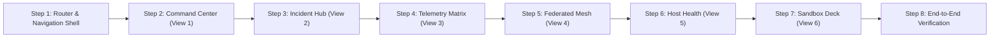

# FedThreat Edge Sentinel: Client Dashboard UI Requirements & Architectural Specification

> **Document Type:** Software Requirements Specification (SRS) & UI/UX Architectural Blueprint  
> **Target System:** FedThreat Client / Edge Sentinel Node (Frontend Dashboard)  
> **Author:** Antigravity (Advanced Agentic AI Assistant)  
> **Project Lead:** Adithyan Manoj  
> **Academic Guide:** Dr. Soja Salim  
> **Target Device Baseline:** Client Host (e.g., `Adithyan's MacBook Air` / Windows & Linux Edge Clients)  
> **Date:** October 31, 2026  

---

## Table of Contents

1. [Executive Summary & Purpose](#1-executive-summary--purpose)
2. [FedThreat Client System Analysis (What Our Edge Actually Does)](#2-fedthreat-client-system-analysis)
3. [Industry Research: How Commercial & Modern SIEM/EDR/SOC Dashboards Structure Information](#3-industry-research-siemedrsoc-benchmarking)
4. [Information Architecture & Multi-Page Navigation Structure](#4-information-architecture--multi-page-navigation-structure)
5. [Detailed View & Page Specifications](#5-detailed-view--page-specifications)
   - [View 1: Command Center (Executive Security Overview)](#view-1-command-center-executive-security-overview)
   - [View 2: Incident Hub & MITRE ATT&CK Workbench (Threat Investigation & SOAR)](#view-2-incident-hub--mitre-attck-workbench)
   - [View 3: Multi-Sensor Telemetry & Ingestion Matrix (5x Ingress Classifiers)](#view-3-multi-sensor-telemetry--ingestion-matrix)
   - [View 4: Federated Intelligence & FLoRA Mesh (Flower Cloud Sync & Privacy)](#view-4-federated-intelligence--flora-mesh)
   - [View 5: Host Telemetry & Hardware Diagnostics (System Resources)](#view-5-host-telemetry--hardware-diagnostics)
   - [View 6: Simulation Sandbox & Demonstration Switchboard (Testing & Evaluator Deck)](#view-6-simulation-sandbox--demonstration-switchboard)
6. [Persistent Global Navigation & Header Shell](#6-persistent-global-navigation--header-shell)
7. [Design System & Visual Language Guidelines](#7-design-system--visual-language-guidelines)
8. [Data Contracts & FastAPI Backend Integration Roadmap](#8-data-contracts--fastapi-backend-integration-roadmap)
9. [Step-by-Step UI Redesign Implementation Roadmap](#9-step-by-step-ui-redesign-implementation-roadmap)

---

## 1. Executive Summary & Purpose

FedThreat is a privacy-preserving, federated cyber threat intelligence framework designed to detect complex and zero-day threats across distributed organizations without centralizing private customer logs.

In earlier development iterations, all UI widgets—hardware resource meters, threat graphs, telemetry streams, alert playbooks, and federation buttons—were compressed into a single, vertically scrolling dashboard page. While functional for proof-of-concept testing, stuffing all capabilities into one view creates:
* **Cognitive Overload:** Security analysts cannot triage urgent incidents when cluttered by raw sensor schemas, hardware diagnostics, and simulation toggles.
* **Lack of Operational Separation:** Enterprise SOC tools separate **triage**, **forensics/investigation**, **telemetry ingestion**, **machine learning health**, and **system operations** into distinct specialized views.
* **Loss of Professional Credibility:** Real enterprise EDR/SIEM dashboards (CrowdStrike, Cortex XDR, Microsoft Sentinel) employ clean navigation bars, focused workspaces, and clear visual hierarchies.

This specification defines the complete requirements for a **modular, multi-page client dashboard** that accurately reflects our underlying multi-stage intelligence pipeline while adhering to top-tier enterprise cybersecurity UX standards.

---

## 2. FedThreat Client System Analysis

Our client dashboard must be built upon the actual capabilities and components running inside the `client/` edge sentinel node. The architecture consists of four distinct operational layers:

```
+===================================================================================================+
|                                    FEDTHREAT CLIENT ARCHITECTURE                                  |
+===================================================================================================+
| 1. INGRESS SENSOR SUITE (5x XGBoost Models)                                                       |
|    - Network Flows: CIC-IDS2018 (Dst Port, Flow Duration, Packets/s) -> < 1.8ms                  |
|    - Auth & IAM: BGL Loghub / Syslog (failed_attempts, entropy, hour) -> < 1.2ms                 |
|    - Host Sysmon: DARPA TC / Sysmon (process_depth, privileged_syscalls) -> < 1.4ms               |
|    - Web HTTP / API: CSIC 2010 (payload_entropy, sqli_signatures) -> < 1.1ms                     |
|    - Cloud Audit: AWS CloudTrail (AssumeRoleCount, error_rate) -> < 1.5ms                         |
+---------------------------------------------------------------------------------------------------+
| 2. TEMPORAL EVENT CORRELATION (edge/correlator.py)                                                |
|    - 5-Minute Sliding Time Window grouping cross-sensor anomalies by host IP/entity               |
|    - CTI Narrative Synthesizer: Converts raw tabular anomalies into natural language attack prose |
|    - Dynamic Threat Store: Real incident persistence & localized attack velocity tracking        |
+---------------------------------------------------------------------------------------------------+
| 3. SEMANTIC CTI CLASSIFIER & PRIVATE RAG (edge/rag_engine.py)                                     |
|    - Base Model: ehsanaghaei/SecureBERT (125M params, 50,265 CTI tokens)                         |
|    - PEFT LoRA Adapter: r=8, alpha=16 trained on 2,364 100% authentic CTI reports (MPS/GPU)      |
|    - 6 MITRE Classes: T1190, T1059, T1078, T1068, T1070, T1498 (83.47% test accuracy)            |
|    - Local ChromaDB Vector DB:                                                                    |
|        * mitre_enterprise (858 global MITRE ATT&CK technique chunks)                             |
|        * client_org_profile (Localized client host profile & historical incident memory)          |
|    - Llama-3 Generative Advisory: Mitigation playbooks & SOC containment checklists               |
+---------------------------------------------------------------------------------------------------+
| 4. FEDERATED LEARNING SENTINEL CLIENT (edge/fl_client.py)                                         |
|    - Flower gRPC client connecting to central cloud aggregator (Colab/Cloud GPU)                  |
|    - FLoRA adapter weight upload (ΔW) without transmitting raw network/host logs                   |
|    - Differential Privacy (DP) budget accounting (ε = 0.5, δ = 10^-5)                             |
|    - Zero-latency in-memory LoRA weight fusion via merge_and_unload()                             |
+===================================================================================================+
```

---

## 3. Industry Research: SIEM/EDR/SOC Benchmarking

To ensure FedThreat looks and operates like an elite commercial cybersecurity tool, we benchmarked the information architecture of the leading enterprise security suites:

### 3.1. CrowdStrike Falcon
* **Information Architecture:** Left persistent sidebar with categorized navigation (Activity, Endpoint Security, Threat Intelligence, Configuration).
* **UX Highlights:**
  * **Device Chip:** Always shows hostname, internal IP, sensor version, and containment state in the top header.
  * **Incident Workbench:** Multi-stage graphical timeline connecting Initial Access to Lateral Movement.
  * **Zero-Trust Assessment (ZTA):** A unified 1-100 score reflecting host patch status, OS integrity, and hardware health.
  * **Action Controls:** Clear, dangerous action buttons (`[Network Contain Host]`, `[Pull Forensic Package]`) kept separate from observational monitoring.

### 3.2. Palo Alto Networks Cortex XDR
* **Information Architecture:** Separates **Incidents**, **All Alerts**, **Causality View (Process Trees)**, and **Action Center**.
* **UX Highlights:**
  * Visualizes the exact process hierarchy (`launchd` -> `bash` -> `curl` -> `payload.sh`).
  * Telemetry rate graphs showing packets/sec and log ingest volume per source.
  * MITRE ATT&CK matrix view with illuminated cells representing detected techniques.

### 3.3. Microsoft Defender for Endpoint / Sentinel
* **Information Architecture:** Multi-tab workspace with **Overview**, **Incidents & Alerts**, **Hunting (Query Engine)**, **Device Health**, and **Configuration**.
* **UX Highlights:**
  * Top KPI cards with trend indicators (`+4.2% from last 24h`).
  * Automated Investigation & Response (AIR) playbooks with clear progress statuses (`Investigating`, `Awaiting Action`, `Remediated`).
  * Granular hardware metric telemetry (CPU, RAM, disk queue) to identify crypto-mining or DoS CPU exhaustion.

### 3.4. Wazuh (Open-Source SIEM/XDR)
* **Information Architecture:** Agent-centric dashboard with distinct tabs: Security Events, Integrity Monitoring, Vulnerabilities, System Auditing, and Agent Status.
* **UX Highlights:**
  * Clean agent status badges (`Active`, `Disconnected`, `Pending`).
  * Categorized bar charts and donut distributions for top rules triggered.

---

## 4. Information Architecture & Multi-Page Navigation Structure

Rather than forcing every feature into a single dashboard view, the redesigned FedThreat Client Dashboard will be organized into **6 dedicated, purpose-built views** accessible via a modern, persistent Navigation Bar:

```
+---------------------------------------------------------------------------------------------------------------------+
| [LOGO] FEDTHREAT SENTINEL  |  Adithyan's MacBook Air (arm64)  |  [Q Search CVEs/IPs...]  |  [● ONLINE • FEDERATED]  |
+---------------------------------------------------------------------------------------------------------------------+
| [1. Command Center]  [2. Incident Hub]  [3. Telemetry Matrix]  [4. Federated Mesh]  [5. Host Health]  [6. Sandbox]  |
+---------------------------------------------------------------------------------------------------------------------+
|                                                                                                                     |
|                                            ACTIVE VIEW WORKSPACE (Routed)                                           |
|                                                                                                                     |
+---------------------------------------------------------------------------------------------------------------------+
| FOOTER: Agent v3.2-MPS | Node ID: Adithyans-MacBook-Air | ChromaDB RAG: Active | Privacy: Zero Raw Logs Shared      |
+---------------------------------------------------------------------------------------------------------------------+
```

### Purpose of Each Dedicated View

| View / Page | Primary User Task | Core Question Answered |
| :--- | :--- | :--- |
| **1. Command Center** | Executive & Real-Time Posture Overview | *"Is my system safe right now, and what is the overall threat posture?"* |
| **2. Incident Hub** | Forensic Investigation & Incident Playbooks | *"What attack occurred, what is the MITRE classification, and what must I do?"* |
| **3. Telemetry Matrix** | Multi-Sensor Ingestion & Packet Inspection | *"What are the 5 sensors ingesting, and what does the raw telemetry look like?"* |
| **4. Federated Mesh** | Collaborative Learning & Privacy Auditing | *"How is this node contributing weights to the Cloud Server without leaking data?"* |
| **5. Host Health** | Edge Hardware Profiling & Diagnostics | *"Are CPU, RAM, GPU/MPS, Disk, and thermals within safe operating limits?"* |
| **6. Sandbox & Demo** | Simulation & Evaluator Testing Deck | *"How can I safely trigger attacks and demonstrate the 4 ML stages to reviewers?"* |

---

## 5. Detailed View & Page Specifications

### View 1: Command Center (Executive Security Overview)

**Objective:** The default landing page for the security operator or system owner. Provides high-impact situational awareness at a glance without clutter.

#### Key Sections & Components:
1. **Host Status & Security Posture Banner:**
   * Dynamic Hostname: `Adithyan's MacBook Air` (`Adithyans-MacBook-Air`).
   * Zero-Trust Health Score: Large radial dial (e.g., `88 / 100 - Good Security Posture`).
   * Active Defense Mode: Badge showing `Autonomous Defense Active (SecureBERT LoRA v3)`.
   * Live Threat Sentinel State: Green pulsing `PROTECTED` or Red flashing `THREAT MITIGATION IN PROGRESS`.
2. **Executive KPI Ribbon (4 Cards):**
   * **Active Threat Alerts:** Total unresolved incidents requiring action (e.g., `1 Critical`, `2 Medium`).
   * **Ingress Telemetry Rate:** Current packets/sec across all 5 sensors (e.g., `1,420 pkts/s`).
   * **Stage 1 Triage Drop Rate:** Percentage of benign traffic dropped locally (e.g., `99.2% filtered`).
   * **Federated Synced Checkpoint:** Global model iteration (e.g., `FLoRA Global Round 4/10`).
3. **Localized Threat Distribution (ChromaDB Donut Chart):**
   * Donut chart showing attacks specifically targeted at *this* client system:
     * Denial of Service (`T1498`): ~41% (Red)
     * Port Scanning / Recon (`T1046`): ~24% (Orange)
     * Brute Force / IAM (`T1110`): ~15% (Amber)
     * Zero-Day / Novelty (`T1190`): ~13% (Purple)
     * Web / API Injection (`T1059`): ~7% (Green)
   * Center Text: Total blocked events (e.g., `143 TOTAL BLOCKED`).
4. **24-Hour Ingress Velocity & Spike Graph (Bar / Area Chart):**
   * Hourly attack frequency showing historical volume with glowing gradient peak spike (e.g., `14:00 UTC Peak: 450 threats`).
   * Time range selectors: `1H`, `24H`, `7D`, `1W`.
5. **Latest High-Severity Incident Quick-Action Banner:**
   * Summarizes the most recent critical detection with direct link to View 2 (`[Investigate in Incident Hub ->]`).

---

### View 2: Incident Hub & MITRE ATT&CK Workbench

**Objective:** The dedicated workspace for deep incident investigation, explainable AI analysis, and executing SOAR remediation playbooks.

#### Key Sections & Components:
1. **Active Incident Header:**
   * Classification Badge: `🚨 CRITICAL: T1498 - Network Denial of Service`.
   * SecureBERT AI Confidence: Large display (e.g., `96.4% Confidence`).
   * Severity Tag: `P1 - HIGH IMPACT`.
   * Timestamp & Target Asset: `Adithyan's MacBook Air (Port 443 / TLS)`.
2. **Cross-Source Event Correlation Narrative (Stage 2):**
   * Human-readable narrative generated by `edge/correlator.py`:
     > *"Detected anomalous TCP network flow targeting destination port 443 on host Adithyan's MacBook Air. Flow lasted 12,000 microseconds transmitting 4,500 forward packets, exhibiting asymmetric volumetric flood signatures characteristic of high-rate SYN flood resource exhaustion."*
3. **MITRE ATT&CK 6-Class Tactical Matrix:**
   * Visual matrix highlighting the 6 authentic CTI classes supported by our fine-tuned SecureBERT model:
     * `T1190: Initial Access (Exploit Public-Facing App)`
     * `T1059: Execution (Command & Scripting Interpreter)`
     * `T1078: Persistence (Valid Accounts)`
     * `T1068: Privilege Escalation (Exploitation for Priv Escalation)`
     * `T1070: Defense Evasion (Indicator Removal on Host)`
     * `T1498: Impact (Network Denial of Service)`
   * The classified technique lights up with an electric purple/crimson glow and confidence sub-meter.
4. **Llama-3 Generative Incident Mitigation Hub (Stage 4 Private RAG):**
   * **Executive Summary:** Plain-English summary of attacker intent, vector, and blast radius.
   * **Immediate Incident Response (SOC Interactive Checklist):**
     * `[x] Drop incoming traffic originating from source CIDR 192.168.1.0/24`
     * `[ ] Rate-limit ingress TCP SYN packets on destination Port 443 via macOS pfctl firewall`
     * `[ ] Trigger priority LoRA parameter delta upload (ΔW) to Cloud Aggregator`
     * `[ ] Isolate host from internal local corporate subnet`
   * **Long-Term Architecture Hardening:**
     * Upstream scrubbing policies, rate-limiting rules, and local ChromaDB memory synchronization.
5. **Remediation Action Controls:**
   * `[Block Source IP / CIDR]` — Immediate firewall containment.
   * `[Quarantine Host / Interface]` — Disables non-management networking.
   * `[Push Local Weights to Colab]` — Triggers Federated LoRA weight extraction.
   * `[Export Incident Dossier (PDF/JSON)]` — Complete compliance report download.

---

### View 3: Multi-Sensor Telemetry & Ingestion Matrix

**Objective:** Inspect and audit the 5 specialized XGBoost ingress sensors filtering live client data streams.

#### Key Sections & Components:
1. **5-Sensor Health & Throughput Dashboard:**
   * Grid of 5 sensor cards representing our Phase 3 trained models:
     1. **Network Flow Sensor (CIC-IDS2018):** `1,240 pkts/s` • Model Latency: `1.8 ms` • Accuracy: `99.82%`.
     2. **Authentication & IAM Sensor (BGL / Syslog):** `14 events/min` • Model Latency: `1.2 ms` • Accuracy: `99.41%`.
     3. **Host Sysmon Sensor (DARPA TC):** `94 logs/s` • Model Latency: `1.4 ms` • Accuracy: `99.18%`.
     4. **Web HTTP / API Sensor (CSIC 2010):** `45 req/s` • Model Latency: `1.1 ms` • Accuracy: `99.64%`.
     5. **Cloud Audit Sensor (AWS CloudTrail):** `8 events/min` • Model Latency: `1.5 ms` • Accuracy: `99.55%`.
   * Each card features an active status beacon (`ONLINE`), 60-second throughput sparkline, and anomaly counter.
2. **Live Telemetry Stream Table:**
   * Real-time scrolling table mapping incoming packet/log records:
     * `Status Dot:` Green (Benign), Amber (Suspect), Crimson (Anomaly).
     * `Timestamp:` Microsecond precision (`14:32:05.102`).
     * `Sensor Source:` Network, Auth, Sysmon, Web, or CloudTrail.
     * `Flow / Routing:` `10.0.4.12:51240 -> 192.168.1.1:443`.
     * `Protocol / Port:` `TCP / 443`, `UDP / 53`, `HTTP / 80`.
     * `Telemetry Sparkline:` Micro-wave showing volumetric flow.
     * `AI Confidence:` Visual horizontal progress bar (e.g., `98%`).
     * `Actions:` 3-dot kebab menu (`Inspect Payload`, `Copy IP`, `Block`).
3. **Slide-Out Raw Payload Inspector Drawer:**
   * Click any row to expand a formatted JSON & Hex viewer displaying the exact 15-feature numeric tensor passed to XGBoost alongside raw log strings.
   * "Copy JSON" button and feature normalization verification badge.

---

### View 4: Federated Intelligence & FLoRA Mesh

**Objective:** Provide transparent visualization and auditing of the federated learning process, proving that raw data remains local while model intelligence is shared.

#### Key Sections & Components:
1. **Federated Mesh Topology & Connection Card:**
   * Central Aggregator Address: `ngrok.app:8080 (Google Colab / Cloud GPU)`.
   * Transport Protocol: `gRPC (HTTP/2 Encrypted Tunnel)`.
   * Client Node Status: `Registered & Active in server_registry.db`.
   * Active Strategy: `FedThreatFLoRAStrategy (Heterogeneous LoRA Aggregation)`.
2. **Federated Training Round Progress:**
   * Large visual step counter: `Global Round 4 of 10`.
   * Local Adapter Sync Status: `Synced • Checkpoint v3.2-MPS`.
   * Local LoRA Parameters: `890,118 weights (0.71% trainable of 125M SecureBERT)`.
   * Dynamic weight fusion status: `merge_and_unload() Active (Zero-Latency Local Inference)`.
3. **Differential Privacy (DP) & Governance Meter:**
   * Privacy Budget Consumption: $\epsilon = 0.5$, $\delta = 10^{-5}$.
   * Noise Mechanism: `Rényi Differential Privacy / Laplace Noise Layer`.
   * Privacy Guarantee Seal:
     > **"100% Parameter Isolation: Zero raw packets, user logs, or customer credentials are ever transmitted outside this edge node."**
4. **Local vs. Global Loss & Model Drift Chart:**
   * Dual line graph comparing local client training loss against the global aggregated model across rounds 1 through 10.
5. **Federated Synchronization Audit Log:**
   * Chronological audit trail showing:
     * `14:00:12` — Received global base adapter from Cloud Server (Shape: 768x8).
     * `14:02:45` — Local LoRA fine-tuning completed (3 epochs on MPS GPU).
     * `14:02:48` — Transmitted parameter delta $\Delta W$ (Size: 3.55 MB).
     * `14:03:00` — Global weights aggregated; local in-memory fusion complete.

---

### View 5: Host Telemetry & Hardware Diagnostics

**Objective:** Deep-dive operational monitoring of the client machine’s hardware, ensuring the edge machine is healthy and local PyTorch/MPS inference does not degrade user productivity.

#### Key Sections & Components:
1. **Hardware Resource Metrics (4 Big Cards):**
   * **CPU Load:** Real-time percentage (`24.5%`), core load distribution (8 cores), load average (1m, 5m, 15m).
   * **Memory (RAM):** Used vs. Total (e.g., `6.2 GB / 16.0 GB` • `38.7%`), swap usage, memory allocation bar.
   * **GPU / Accelerator VRAM:** Dedicated Apple Silicon MPS / CUDA meter (e.g., `3.1 GB / 8.0 GB`), device name: `Apple M-Series Metal Performance Shaders (MPS)`.
   * **System Uptime & Thermals:** Uptime (e.g., `142.9h`), thermal envelope (`Normal • 48°C`), battery/power source.
2. **Storage & Database Disk Footprint:**
   * ChromaDB MITRE Vector Store: `45.2 MB` (858 vectors).
   * Client Profile Vector Store: `1.8 MB` (Personalized memory).
   * Model Weights on Disk: `XGBoost: 1.2 MB`, `SecureBERT LoRA: 3.55 MB`.
   * Telemetry Cache & Log Rotation: `12.4 MB / 100 MB Max`.
3. **ML Pipeline Execution Latency Profiler (Benchmark Card):**
   * Interactive benchmark displaying real microsecond/millisecond execution times for each of the 4 pipeline stages:
     * `Stage 1: Multi-Sensor XGBoost Triage` -> **`1.4 ms`**
     * `Stage 2: Cross-Sensor Event Correlator` -> **`3.5 ms`**
     * `Stage 3: SecureBERT LoRA Semantic Classifier` -> **`42.8 ms` (MPS Accelerated)**
     * `Stage 4: Private ChromaDB RAG & Advisory` -> **`340.5 ms`**
     * **Total Pipeline Latency:** **`< 390 ms`** (Sub-second end-to-end autonomous triage).

---

### View 6: Simulation Sandbox & Demonstration Switchboard

**Objective:** A purpose-built, dedicated testing and presentation deck where researchers, evaluators, and teammates can safely inject attacks, toggle modes, and verify system behavior in real time.

#### Key Sections & Components:
1. **Interactive Attack Injection Switchboard:**
   * **"Inject Volumetric DDoS Attack (T1498)"** — Simulates high-rate SYN flood on Port 443 with 4,500 forward packets.
   * **"Inject IAM Brute Force Attempt (T1110)"** — Simulates anomalous failed SSH logins and entropy spikes.
   * **"Inject Web SQLi Injection (T1059)"** — Simulates Layer 7 URI traversal and database parameter injection.
   * **"Send Benign Normal Traffic"** — Sends standard TLS web traffic to demonstrate Stage 1 triage dropping normal packets.
2. **Zero-Day vs. Known Threat Federation Toggle:**
   * **Toggle Switch:**
     * *ON (Zero-Day Mode):* Routes detected anomaly to Cloud Server for priority FLoRA collaborative adapter fine-tuning.
     * *OFF (Known Threat Mode):* Uses fast local XGBoost + SecureBERT inference only; skips cloud synchronization.
3. **Manual PCAP & Log File Ingestion Deck:**
   * Drag-and-drop zone for `.pcap`, `.csv`, and `.json` log files to evaluate custom threat datasets.
4. **Live Execution Stepper (Visual Flow):**
   * Real-time visual animation illuminating each stage as packets flow through:
     * `Packet Ingest` -> `Stage 1 XGBoost (Pass/Flag)` -> `Stage 2 Correlator (Narrative)` -> `Stage 3 SecureBERT (Class)` -> `Stage 4 RAG (Mitigate)`.

---

## 6. Persistent Global Navigation & Header Shell

The top navigation shell persists across all 6 views to provide continuous context:

### Left Region:
* **Brand Logo:** FedThreat Shield Icon with emerald status glow.
* **Product Title:** `FEDTHREAT` `<SENTINEL>`
* **Host Identity Pill:** `Adithyan's MacBook Air` | `Adithyans-MacBook-Air` (dynamically queried from system OS sockets).

### Center Region:
* **Global Navigation Links:**
  1. `Command Center`
  2. `Incident Hub`
  3. `Telemetry Matrix`
  4. `Federated Mesh`
  5. `Host Health`
  6. `Sandbox & Demo`
* **Pill Search Bar:** `⌘K` shortcut to search IPs, CVEs, MITRE technique IDs, or sensor logs.

### Right Region:
* **Federated Connectivity Badge:** Glowing pill button `● ONLINE • FEDERATED` (clicking toggles quick federation overview).
* **Cloud Aggregator Quick Link:** Direct button to view the central Google Colab server dashboard (`/cloud`).
* **Active Alert Bell:** Notification icon with numeric unread counter (`3`).
* **User Identity Avatar:** Initials (`AM`) with status beacon.

---

## 7. Design System & Visual Language Guidelines

### 7.1. Color Tokens (Modern Cybersecurity Dark Mode)
* **Backgrounds:**
  * `Canvas Void:` `#060709` (Deepest background)
  * `Panel Surface:` `#0d0f12` (Elevated card containers)
  * `Sub-Panel / Input:` `#07080b` (Deep inset areas)
  * `Card Hover / Active:` `#131720` (Interactive card states)
* **Borders & Dividers:**
  * `Border Subtle:` `#1a1e27` (Clean structural outlines)
  * `Border Active / Highlight:` `#262d3a`
* **Status & Severity Accents:**
  * `Safe / Operational:` `#10b981` (Emerald Green)
  * `Federated / Intelligence:` `#8b5cf6` (Electric Violet / Purple)
  * `Warning / Medium:` `#f59e0b` (Amber Orange)
  * `Critical Threat / P1:` `#ef4444` (Vibrant Crimson Red)
  * `Information / Telemetry:` `#3b82f6` (Cobalt Blue)

### 7.2. Typography & Numbers
* **UI Typography:** Inter, -apple-system, sans-serif for crystal-clear readability.
* **Telemetry & Code:** JetBrains Mono or Fira Code for all IPs, ports, timestamps, hashes, and JSON schemas.
* **Metrics:** Bold, high-contrast numbers (`text-3xl font-bold text-white`) with muted secondary descriptors (`text-xs text-gray-500`).

### 7.3. UI Micro-Interactions
* **Glow Accents:** Critical alert cards and peak chart bars feature subtle drop-shadow glows (`shadow-[0_0_20px_rgba(239,68,68,0.2)]`).
* **Active Press Feedback:** All buttons feature subtle scale transitions on click (`active:scale-95`).
* **Smooth Page Transitions:** Changing views via the navigation bar utilizes smooth fade/slide transitions without reloading the page.

---

## 8. Data Contracts & FastAPI Backend Integration Roadmap

The redesigned frontend communicates with the local FastAPI backend (`edge/main.py`) running on Port 8000:

| API Endpoint | HTTP Method | Data Provided / Purpose | Corresponding View |
| :--- | :--- | :--- | :--- |
| `/api/client_node_info` | `GET` | Dynamic laptop hostname, OS specs, node ID | Global Header |
| `/api/system_status` | `GET` | CPU, RAM, GPU/MPS, Disk usage, Uptime | Views 1 & 5 |
| `/api/threat_distribution` | `GET` | Real threat distribution from local ChromaDB | View 1 |
| `/api/temporal_volume` | `GET` | Real hourly incident volume and peak spikes | View 1 |
| `/api/telemetry_events` | `GET` | Live scrolling event history across all sensors | Views 1 & 3 |
| `/api/sensor_health` | `GET` | Throughput and latency for the 5 XGBoost sensors | View 3 |
| `/api/federation_status`| `GET` | Flower gRPC connection, current round, DP budget | View 4 |
| `/api/telemetry` | `POST` | Injects traffic and runs the full 4-stage ML pipeline | Views 2 & 6 |
| `/api/health_report` | `GET` | Generative Llama-3 situational military health report | View 5 |

---

## 9. Step-by-Step UI Redesign Implementation Roadmap



### Execution Phases:
1. **Phase 1: Multi-Page Navigation Shell:** Update `App.jsx` with React Router navigation tabs (`/`, `/incidents`, `/telemetry`, `/federation`, `/health`, `/sandbox`) and the persistent header.
2. **Phase 2: Modular Page Decoupling:** Reorganize existing components into dedicated view components inside `frontend/src/pages/`:
   * `CommandCenter.jsx` (High-level posture & charts)
   * `IncidentHub.jsx` (Deep investigation & MITRE playbook)
   * `TelemetryMatrix.jsx` (5-sensor monitoring & raw inspector)
   * `FederatedMesh.jsx` (Flower connection & LoRA weights)
   * `HostHealth.jsx` (Granular hardware & latency profiler)
   * `SimulationSandbox.jsx` (Interactive demo switchboard)
3. **Phase 3: Backend Endpoint Alignment:** Ensure `edge/main.py` supplies dedicated data models for all 6 views with zero missing fields.
4. **Phase 4: Polish & Verification:** Verify all routes, responsive viewports, and interactive actions on the Vite development server.

